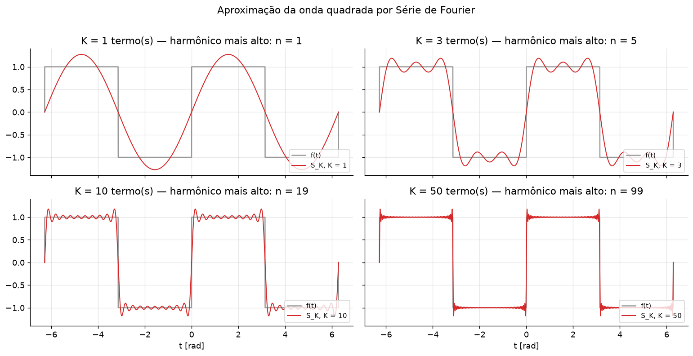
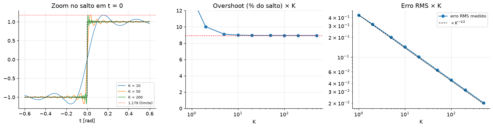
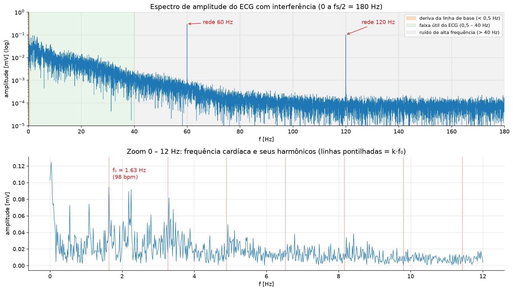
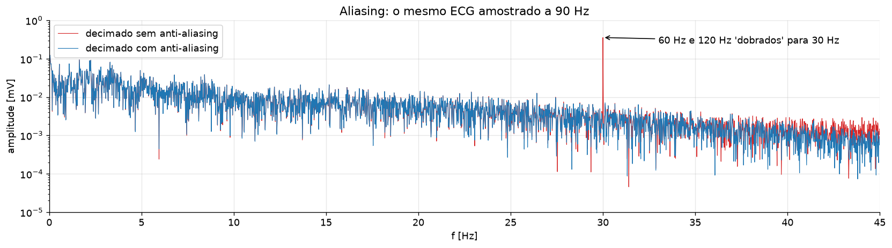
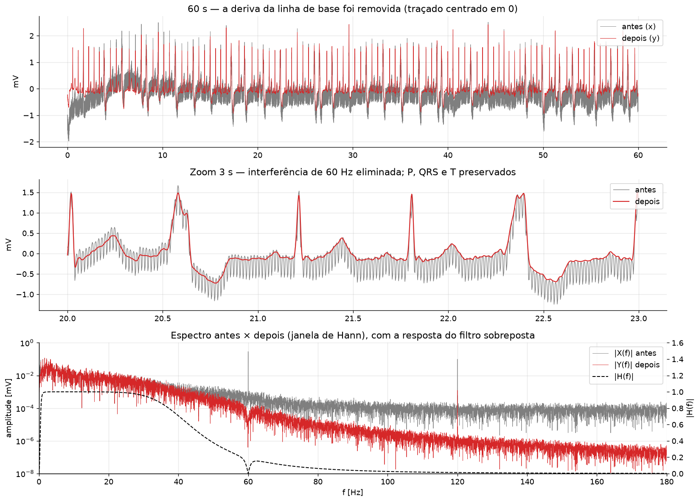
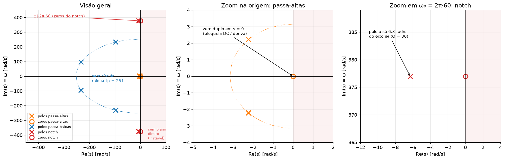
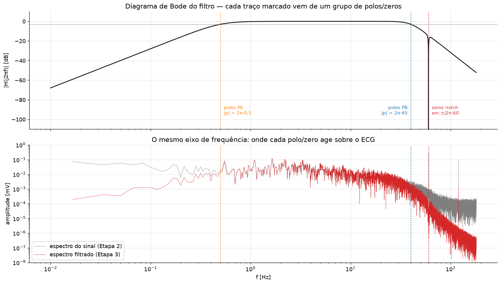

# Do sinal ao espectro: um analisador e filtro de sinais

**Sistematização · Métodos Matemáticos — CEUB**
Séries de Fourier → Transformada de Fourier → Transformada de Laplace

| | |
|---|---|
| **Aluno** | Julio Cesar Sousa Oliveira — RA 22308014 |
| **Sinal** | Eletrocardiograma (ECG) real — registro 208 do *MIT-BIH Arrhythmia Database* (PhysioNet), derivação MLII, $f_s = 360$ Hz |
| **Notebook** | [`sistematizacao_sinais.ipynb`](sistematizacao_sinais.ipynb) |
| **Vídeo de apresentação** | _(inserir link)_ |

---

## Objetivo

Construir um analisador e filtro de sinais para um ECG contaminado por três tipos de ruído comuns em eletrocardiografia:

- **deriva da linha de base**, causada por respiração e movimento dos eletrodos (abaixo de 0,5 Hz);
- **interferência da rede elétrica**, em 60 Hz e no harmônico de 120 Hz;
- **ruído de alta frequência**, acima de 40 Hz.

A meta é remover esses ruídos sem deformar o complexo QRS e, em seguida, descrever o filtro usado como um sistema linear $H(s)$.

O ECG vem do registro original. A interferência da rede (0,30 mV em 60 Hz e 0,10 mV em 120 Hz) foi somada ao sinal de forma controlada e com semente fixa, para que o problema seja completo e reprodutível. Toda a análise usa uma janela de 60 s (de 240 s a 300 s do registro), um trecho de ritmo regular.

---

## Etapa 1 — Série de Fourier (Unidades 1 e 2)

Aproximação da onda quadrada de período $2\pi$ por somas parciais da Série de Fourier.

- **Coeficientes** calculados de forma simbólica (sympy) e conferidos numericamente: $a_0 = a_n = 0$ e $b_n = \dfrac{2(1-(-1)^n)}{n\pi}$, ou seja, $b_n = \dfrac{4}{n\pi}$ para $n$ ímpar.
- **Forma complexa:** $c_n = -\dfrac{2j}{n\pi}$ para $n$ ímpar, com $c_{-n} = \overline{c_n}$. A reconstrução pela forma complexa coincide com a trigonométrica (diferença máxima de $10^{-15}$).
- **Fenômeno de Gibbs:** o pico da soma parcial converge para $\frac{2}{\pi}\mathrm{Si}(\pi) \approx 1{,}179$, um *overshoot* de **8,95 % do salto** que não diminui com o número de termos. Já o erro RMS cai como $K^{-1/2}$: a convergência é em média quadrática, mas não uniforme.
- **Ortogonalidade:** a matriz de Gram de $\{1, \cos nt, \sin nt\}$ é diagonal. Isso justifica calcular cada coeficiente como uma projeção independente.




---

## Etapa 2 — Do tempo para a frequência (Unidade 3)

FFT da janela de 60 s, com $N = 21\,600$ amostras.

- **Frequência de Nyquist:** 180 Hz.
- **Resolução em frequência:** $\Delta f = f_s/N = 0{,}0167$ Hz.

| Componente | Onde aparece no espectro |
|---|---|
| Frequência cardíaca | pico fundamental em **1,63 Hz (≈ 98 bpm)** e harmônicos. Confere com a contagem de picos R no tempo (99,5 bpm) |
| Deriva da linha de base | energia concentrada abaixo de 0,5 Hz |
| Conteúdo útil do ECG | entre 0,5 e 40 Hz (ondas P e T nas frequências baixas, QRS nas altas) |
| Rede elétrica | duas linhas isoladas, em 60 Hz e 120 Hz |

**Aliasing.** Ao reamostrar o sinal a 90 Hz sem filtro anti-aliasing, as componentes de 60 e 120 Hz se "dobram" para 30 Hz, dentro da faixa útil do ECG. Com o filtro anti-aliasing, esse pico desaparece.




---

## Etapa 3 — Filtrar e reconstruir (Unidade 3)

O filtro é uma cascata de três blocos analógicos, cada um voltado a um problema identificado no espectro:

| Bloco | Projeto | Alvo |
|---|---|---|
| Passa-altas | Butterworth, 2ª ordem, $f_c = 0{,}5$ Hz | deriva da linha de base |
| Passa-baixas | Butterworth, 4ª ordem, $f_c = 40$ Hz | ruído acima de 40 Hz e o harmônico de 120 Hz |
| Notch | 2ª ordem, $f_0 = 60$ Hz, $Q = 30$ | interferência da rede |

**Aplicação.** A filtragem é feita no domínio da frequência, $Y(f) = |H(f)|\,X(f)$. O sinal filtrado é reconstruído pela **Transformada de Fourier Inversa**, com espelhamento das bordas e fase zero, o que preserva a posição e a forma do QRS.

**Validação.** O resultado foi comparado com um filtro IIR digital equivalente (`sosfiltfilt`), com correlação de 0,998.

| Faixa | Atenuação |
|---|---|
| Rede 60 Hz | **−56 dB** |
| Rede 120 Hz | **−38 dB** |
| Deriva (< 0,5 Hz) | −14 dB |
| Faixa útil (0,5–40 Hz) | **−0,1 dB** |

A correlação do QRS entre o ECG original e o filtrado é de **0,9999**, e a amplitude média do pico R cai apenas 1,3 %.



---

## Etapa 4 — O filtro como sistema linear (Unidade 4)

- **Ponto de partida, o filtro RC:** a partir de $RC\,y' + y = x$, a Transformada de Laplace dá $H(s) = \dfrac{1}{1+sRC}$. A resposta ao impulso $h(t) = \frac{1}{RC}e^{-t/RC}$ e a resposta ao degrau foram obtidas no sympy.
- **Filtro completo:** $H(s) = H_{PA}(s)\,H_{PB}(s)\,H_N(s)$, com **8 polos e 4 zeros**.
- **Estabilidade:** todos os polos têm $\mathrm{Re}(s) < 0$, logo o sistema é **estável**. A resposta ao impulso decai e $\int|h(t)|\,dt$ é finita.
- **Ligação com a Etapa 2:**

| Comportamento no espectro | Origem no plano $s$ |
|---|---|
| Ganho nulo em DC | zero duplo em $s = 0$ |
| Banda passante plana | 4 polos Butterworth sobre um semicírculo de raio $2\pi\cdot40$ |
| Queda de 80 dB/década acima de 40 Hz | efeito dos 4 polos do passa-baixas |
| Nulo exato em 60 Hz | zeros sobre o eixo imaginário em $\pm j2\pi\cdot60$ |
| Vale estreito em 60 Hz | polos do notch muito próximos dos zeros, a apenas $\omega_0/2Q$ do eixo $j\omega$ |




---

## Conclusão

Os três ruídos, que no tempo aparecem misturados ao ECG, ficam separados no domínio da frequência. Isso permite removê-los com um filtro simples e justificável, sem perda da informação clínica.

O mesmo filtro, escrito como $H(s)$, tem todo o seu comportamento descrito pela posição de polos e zeros. O espectro e o plano $s$ contam a mesma história em duas linguagens.

---

## Reprodutibilidade

**Google Colab.** Abra o notebook no Colab (*Arquivo → Abrir notebook → GitHub*, colando a URL deste repositório) e use *Ambiente de execução → Executar tudo*. Se a pasta `dados/` não estiver disponível, o sinal é baixado automaticamente via `scipy.datasets`.

**Execução local:**

```bash
pip install -r requirements.txt
jupyter notebook sistematizacao_sinais.ipynb
```

O ruído sintético usa semente fixa (`np.random.seed(42)`), então os resultados são idênticos a cada execução.

### Estrutura

```
├── sistematizacao_sinais.ipynb   # código das 4 etapas + interpretação de cada gráfico
├── dados/
│   ├── ecg_mitbih208_360hz.csv   # registro original (300 s; tempo_s, ecg_mV)
│   └── ecg_filtrado.csv          # janela analisada: sinal com interferência e sinal filtrado
├── figuras/                      # gráficos gerados pelo notebook
├── requirements.txt
└── README.md
```

### Ferramentas

Python · `numpy` · `matplotlib` · `scipy.fft` · `scipy.signal` · `sympy` · Google Colab

## Referências

- Moody, G. B.; Mark, R. G. *The impact of the MIT-BIH Arrhythmia Database*. IEEE Engineering in Medicine and Biology, 20(3):45–50, 2001.
- Goldberger, A. L. et al. *PhysioBank, PhysioToolkit, and PhysioNet*. Circulation, 101(23):e215–e220, 2000.
- Oppenheim, A. V.; Willsky, A. S. *Sinais e Sistemas*. 2ª ed. Pearson, 2010.
